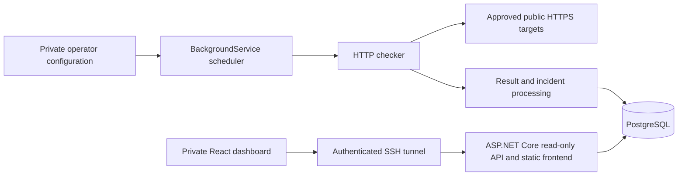

# Architecture and decisions

Status: accepted design direction. M0–M6 are complete: secure monitoring, PostgreSQL persistence/incidents, bounded read APIs, and a React dashboard. The stack is privately deployed on the inspected NUC through SSH. See [M6 deployment evidence](MILESTONE-6.md) and [the M5 implementation](MILESTONE-5.md) and [the M4 API contract](MILESTONE-4.md).

## System shape



The worker, checker, result processing, API, and static frontend are parts of **one ASP.NET Core process**, not separate services. Production starts with one application container and one PostgreSQL container. Local development uses the .NET process, Vite's development server with an API proxy, and local PostgreSQL; database tests use disposable containers.

Use Minimal APIs, ordinary classes, explicit DTOs, built-in dependency injection, and direct EF Core access. Start with one backend project. Do not add generic repositories, CQRS/MediatR, a separate domain assembly, message queues, Redis, Kubernetes, or distributed locks without a demonstrated need.

This keeps the request, scheduling, and persistence paths visible for learning. Single-instance scheduling is an explicit constraint: multiple application replicas would duplicate checks. Scaling needs a separately reviewed coordination design.

## Repository layout

Create application directories only in the milestone that needs them:

```text
Uptime-Urpo.slnx                 # M1: solution grouping API and test projects
global.json                     # M0: SDK selection
backend/UptimeUrpo.Api/          # M1: one backend project
  Program.cs
  Monitoring/
  Contracts/
  Endpoints/
  Persistence/                  # M3
tests/UptimeUrpo.UnitTests/      # M1
tests/UptimeUrpo.IntegrationTests/ # M1 API tests; M3 database tests
frontend/                       # M5
deploy/                         # M6 production packaging and operations
docs/                           # M0 onward
scripts/                        # M0 prerequisite checks
README.md
CSHARP-FOR-ROOPE.md
```

## Monitoring contract

Targets have a stable configuration ID, safe display name, URL, enabled flag, expected HTTP status, interval, and timeout. Configuration is private and validated at startup. Do not put real target credentials or sensitive URLs into example files.

Defaults:

- HTTPS on port 443, exact expected status 200.
- Interval 60 seconds, timeout 10 seconds, maximum three concurrent checks globally.
- Slow-response threshold two seconds; DOWN threshold three consecutive failed checks.
- GET with `ResponseHeadersRead`; duration measures request start through response headers, not full body download or browser page load. Dispose responses promptly.
- No automatic redirects, immediate retries, or request bodies. No overlapping check for one target.

The scheduler uses cancellation-aware asynchronous work, bounded concurrency, and monotonic elapsed time for scheduling/duration measurement. UTC wall-clock timestamps describe results. Slow targets do not block all others. After pauses or restarts, skip missed opportunities instead of generating catch-up bursts. An expected target/network failure becomes a categorized result; host shutdown cancellation does not become a target outage.

Use `IHttpClientFactory` for managed HTTP clients. A worker is long-lived; each concurrent database operation must use a separate service scope and `DbContext`. Never share a context between parallel checks. Inject time and HTTP boundaries where they make deterministic tests possible, rather than introducing broad abstractions.

M1 originally performed one startup check. M2 now uses one sequential async loop per enabled target with a shared semaphore, and a fixed delay after each attempt completes. The first check is due immediately; startup no longer waits for its response. No missed-run queue exists. Timeouts must be shorter than intervals; interval defaults to 60 seconds and concurrency to three. The single-target M1 configuration is supported alongside a new target list, but conflicting shapes are rejected. Reads never trigger target requests. M3 made results durable.

## Health and incidents

Health evaluates freshness first:

- **UNKNOWN:** disabled, no completed check, or the latest completed observation is older than twice the configured interval, measured using monotonic elapsed time. This takes precedence over historical failure state.
- **UP:** fresh expected response at or below the latency threshold.
- **DEGRADED:** fresh expected response above the latency threshold, or a fresh failed response below the consecutive-failure threshold.
- **DOWN:** fresh failures reaching the configured consecutive-failure threshold.

Every successful expected response resets the failure streak. A slow success recovers a DOWN target to DEGRADED. A gap breaks the evidence for consecutive failures; it does not close an already open incident. Persist enough state to preserve open incidents across restarts, while presenting stale health as UNKNOWN.

An incident opens when DOWN is confirmed. Store both the first failure timestamp and the confirmation timestamp. Close it on the first successful expected response. Report elapsed incident duration as the interval between the first failure observation and recovery (or now), with gaps explicitly visible. This is an observed incident window, not proof of continuous downtime throughout a gap. Keep at most one open incident per service.

Unexpected HTTP status, DNS failure, connection failure, timeout, and TLS failure have sanitized categories. HTTP status is null when no response was received. Cancellation from application shutdown is distinct from target timeout. Avoid raw exception text in API responses and sensitive URLs in logs.

## Persistence and observed availability

M3 introduced `MonitoredService`, `MonitoringPeriod`, and `CheckRecord`, with an index on `(ServiceId, CheckedAtUtc)` and a completion-time retention index. M4 adds `IncidentRecord` and a durable pending first-failure time. Results, current snapshots/streaks, and incident transitions share one transaction before the cache is updated. The unique partial incident index permits one open incident per service.

The background worker opens a separate DI scope/context per operation. Startup requires an explicitly migrated schema, synchronizes configuration periods, and restores durable snapshots; UTC age bridges restart, then in-process freshness uses monotonic time again. Missing/unreachable storage leaves readiness unhealthy and delays initialization; write failures discard the unsaved observation and retain gaps without an unbounded queue. The application has no runtime in-memory persistence mode. Test-only stores keep fast unit/API tests independent of Docker.

Record monitoring configuration periods from first enablement so enabled time and interval changes remain available for historical coverage calculations. Disabled periods, time before enrollment, and retired target periods must not be counted as missed monitoring. Stable IDs preserve identity when a display name changes; material target changes must be documented rather than silently rewriting history.

For UTC windows `[start, end)` of 24 hours, seven days, and 30 days:

- **Observed availability:** successful completed checks divided by all completed checks, multiplied by 100.
- Slow expected responses count as successful; any failed check counts as unsuccessful even before DOWN is confirmed.
- No completed checks yields a null percentage, never 100%.
- **Coverage:** occupied nominal slots divided by slots intersecting enabled time. Slots use each configuration period's interval/start anchor; partial window edges count once, and repeated checks in a slot cannot inflate coverage. Disabled/pre-enrollment time contributes no slots. This is sampling density, not a time-weighted SLA; fixed-delay drift can leave nominal slots unoccupied. M4 tests cover mapping and boundaries.
- Missing opportunities are unknown, excluded from the availability denominator, and displayed as chart gaps. These are sample-based statistics, not time-weighted SLA measurements.

Raw check results retain 90 days, using at most 500 deletes per minute by default. Current durable snapshots/configuration periods remain separate. M4 retains closed incidents for 365 days by end time and never expires open incidents, using another bounded batch. At five targets and roughly one check per minute, raw results grow by about 7,200 rows/day or 648,000 over 90 days; no large-data throughput benchmark has been performed.

Database unavailability must not create fabricated history or an unbounded queue. Log sanitized persistence failures, mark readiness unhealthy, and retain gaps after recovery. Recovery of the monitor must not be presented as recovery of a target without a confirming check.

## Read-only HTTP interface

Milestone 1 introduces `/health` and `GET /api/services/{id}` for the single configured target's saved startup result. The rest arrives only when the required data exists:

- `GET /api/services`: safe service summaries.
- `GET /api/services/{id}`: current detail, or 404 for an unknown ID.
- `GET /api/services/{id}/statistics`: fixed availability/coverage windows and current incident.
- `GET /api/services/{id}/history`: bounded time range, aggregated chart data, and explicit gaps.
- `GET /api/services/{id}/incidents`: paginated incident history.
- `GET /api/overview`: overall counts, freshness, and availability/coverage windows.
- `GET /health`: process liveness; target failures do not fail it.
- `GET /health/ready`: readiness; includes database access once persistence is introduced. No sensitive diagnostics in the response.

M4 uses explicit DTOs, offset-bearing ISO-8601 query timestamps normalized to UTC, bounded parameterized SQL aggregates, Problem Details, and OpenAPI JSON. History returns at most 1,000 buckets over a maximum 30-day range inside retention; incidents use ID cursors and pages of 1–100. Read transactions use repeatable-read isolation. Analytics routes permit at most four concurrent requests and 60 per minute, with no queue. Cancellation reaches SQL. Exact contracts and limits are in the M4 guide.

No CRUD, public check-trigger endpoint, URL submission, or authentication subsystem is needed initially. Keep frontend and API on one origin in production; the local Vite proxy avoids unnecessary permissive CORS.

## Security boundaries

The first dashboard and API are private behind the inspected existing access layer. Bind or isolate the origin so that clients cannot bypass that layer. Do not assume Cloudflare identity headers are trustworthy without verifying the network path. Keep health endpoints minimal and expose them only where required.

SSRF protection applies before the first real target check, even with operator-owned configuration:

- Allow only approved HTTPS hostnames and ports; reject URL credentials and literal/non-public destination addresses.
- Normalize hosts and inspect all resolved IPv4/IPv6 addresses, including mapped forms. Reject loopback, private, link-local, metadata, multicast, unspecified, and other non-public destinations.
- Connect to a validated resolved address while retaining the original hostname for certificate validation and SNI. Repeat validation for new connections; a separate DNS preflight followed by ordinary hostname connection is insufficient against rebinding.
- Disable redirects, implicit proxies, and cookies. Do not disable TLS certificate validation.
- Test hostname/address normalization, redirects, DNS changes, and connection behavior without probing the real private network. A loopback test fixture may use explicitly test-only wiring; production validation stays enabled.

Expected 401/403 responses can test an access boundary if deliberately configured, but cannot establish application health behind it. Never broaden a Cloudflare bypass or weaken existing protection to obtain a green status.

Before deployment add inbound rate limits, history/page bounds, container memory/CPU limits, non-root execution, and bounded log retention. PostgreSQL has no published production port. Use a non-superuser runtime role limited to required data operations and a separate migration role. Keep secrets outside Git, command output, application payloads, and public logs. Backups need the same privacy treatment as the database.

## Operations and limitations

Inspect Debian, architecture, Docker/Compose, available capacity, existing services, proxy/access configuration, storage, and port allocations in M6. Do not modify existing NUC services without discussing the implications. Local macOS ARM64 checks are not evidence that the Intel NUC image works.

Production packaging must include health checks, graceful termination, restart policy, isolated networking, persistent database storage, log rotation, and resource limits. Run migrations deliberately with a successful logical backup first. Verify restores into a separate database. Restoring a backup can lose newer observations; rolling back an image does not undo schema changes.

Self-monitoring on the NUC cannot independently detect NUC power/network loss or the monitor's own failure. Missing data is visible uncertainty. Origin checks, access-layer checks, deployment checks, restart checks, and restore checks are separate evidence. An external observer is a future complement, not a promise of the initial implementation.

## Version and design references

M4 adds Microsoft.AspNetCore.OpenApi 10.0.14, using built-in rate limiters and parameterized EF `SqlQuery` for PostgreSQL aggregates. No UI, cache service, or new infrastructure was added. Local migration now makes a private logical backup first; production backup/restore remains a separate M6 responsibility.

M3 pins EF Core/Relational/Design and `dotnet-ef` to 10.0.14, Npgsql EF provider to 10.0.3, and Testcontainers.PostgreSql to 4.16.0. PostgreSQL 18.6 is used locally and in disposable tests. Explicit EF relational pins align assembly patch versions across project references. Tests, not version-number similarity alone, establish compatibility. Migrations run explicitly with the schema owner, while the runtime uses a restricted role.

M2 adds Microsoft.Extensions.TimeProvider.Testing 10.11.0 to test projects only. `TimeProvider` now controls request deadlines, elapsed duration, scheduling delays, and freshness. The production clock remains `TimeProvider.System`; no runtime scheduling library was added.

M1 resolved xUnit 2.9.3, its VSTest runner 4.0.1, Microsoft.NET.Test.Sdk 18.11.0, and Microsoft.AspNetCore.Mvc.Testing 10.0.13 from NuGet. The runner declares support for xUnit v2 and .NET 8 or later. Restore/build/test verified compatibility with the pinned .NET 10 SDK; project lockfiles record transitive versions. The API itself adds no third-party runtime package. OpenAPI tooling is deferred to M4.

Version families were reviewed on 2026-10-25. Resolve exact compatible stable package patches when each dependency is introduced; commit lockfiles and deliberate SDK updates.

- [.NET support policy](https://dotnet.microsoft.com/en-us/platform/support/policy/dotnet-core)
- [.NET 10 official SDK release metadata](https://builds.dotnet.microsoft.com/dotnet/release-metadata/10.0/releases.json)
- [Npgsql EF Core 10 release notes](https://www.npgsql.org/efcore/release-notes/10.0.html)
- [PostgreSQL support policy](https://www.postgresql.org/support/versioning/)
- [Scoped dependencies in background services](https://learn.microsoft.com/en-us/dotnet/core/extensions/scoped-service)
- [OWASP SSRF prevention](https://cheatsheetseries.owasp.org/cheatsheets/Server_Side_Request_Forgery_Prevention_Cheat_Sheet.html)
- [Vite prerequisites](https://vite.dev/guide/)
- [Custom HTTP connection callbacks](https://learn.microsoft.com/en-us/dotnet/api/system.net.http.socketshttphandler.connectcallback?view=net-10.0)
- [ASP.NET Core API integration tests](https://learn.microsoft.com/en-us/aspnet/core/test/integration-tests?view=aspnetcore-10.0)
- [IANA IPv4 special-purpose registry](https://www.iana.org/assignments/iana-ipv4-special-registry/)
- [IANA IPv6 special-purpose registry](https://www.iana.org/assignments/iana-ipv6-special-registry/)
- [.NET 10 background-service startup behavior](https://learn.microsoft.com/en-us/dotnet/core/compatibility/extensions/10.0/backgroundservice-executeasync-task)
- [Time-provider-aware delays](https://learn.microsoft.com/en-us/dotnet/api/system.threading.tasks.task.delay?view=net-10.0)
- [EF migration application and separate identities](https://learn.microsoft.com/en-us/ef/core/managing-schemas/migrations/applying)
- [Testcontainers PostgreSQL module](https://dotnet.testcontainers.org/modules/postgres/)

## Dashboard integration (M5)

React/TypeScript/Vite lives in `frontend/`. Same-origin GET requests use explicit read contracts. No target URL or credentials enter the UI. Overview polls every 30 seconds; history and incidents every 60 seconds. Each resource cancels obsolete work, bounds request duration, pauses when hidden, and preserves prior data with explicit error/staleness labels. Multiple tabs still share the API limits.

Hash routes keep client navigation at `/`; ASP.NET Core serves default/static files without an HTML catch-all. Vite proxies development API calls to the existing loopback listener. Frontend build assets are included under `wwwroot` on publish; the .NET publish target requires an existing frontend build. Local native runs can serve `frontend/dist` after backend restart. This prepares same-origin delivery without introducing deployment infrastructure early.

The SVG chart uses the API's buckets directly. It splits lines at null HTTP timing, preserves missing/disabled buckets, and exposes a keyboard range input and semantic table. It performs no uptime recalculation or client-side gap filling. Statistics use the server's availability/coverage values. History bounds derive from the server snapshot and normalize both timestamps to JavaScript millisecond precision.

Browser times are local with zone labels; query windows remain elapsed UTC hours. Incidents show elapsed sampled-incident time with gap uncertainty. Themes use CSS variables and best-effort local storage. Synthetic browser fixtures are isolated in a development-only server and never imported by the app entry point.

## Private deployment (M6)

One non-root application container serves the UI/API/worker on the NUC's loopback port 8108. PostgreSQL runs as its non-root image user on a project-internal network with no host port; the app also has a dedicated outbound network. A short-lived migration container uses a separate configuration secret and never runs the monitoring worker. Host administrators/Docker users remain trusted.

A multi-stage image builds the frontend and backend without including local settings, credentials, or fixtures. Portable framework-dependent .NET output supports native ARM64 and AMD64 runtime images. Read-only filesystems, bounded temporary mounts/resources/logs, readiness probes, graceful stop, and restart policies constrain operation. Readiness failure alone does not restart an otherwise live process.

Releases use a clean Git snapshot by default, validation before upload, remote/operation locks, a quiescent logical backup before explicit migration, and readiness before switching the current source link. Private state and the database volume survive releases. File-backed secrets grant only runtime config to the app and migration config to the migration task.

The first access layer is existing SSH authentication and an explicitly loopback-bound local forward. Direct LAN access to the origin was blocked; no Cloudflare/Nginx route was created. Changing that boundary requires inspecting the intended Access policy and verifying origin isolation again.

Daily backups use Europe/Helsinki without changing the host timezone. Recovery drills restore into a separate generated database with migration ownership and per-database runtime grants, validate data/access, then drop only that copy. A manual owner-only off-host archive includes passwords/configuration needed for recovery. Image rollback cannot undo schema changes; a full database replacement remains a separately reviewed recovery operation. See [deployment commands and limits](DEPLOYMENT.md).
